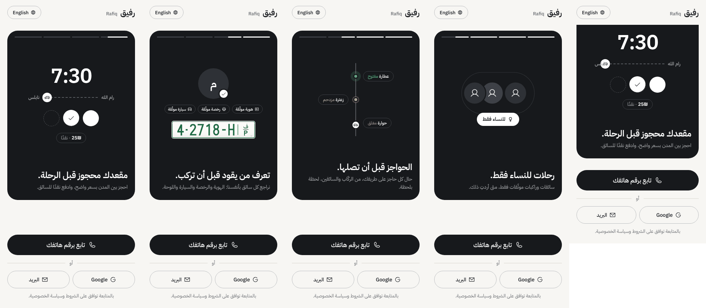
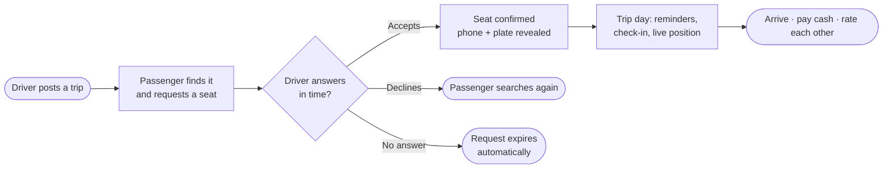
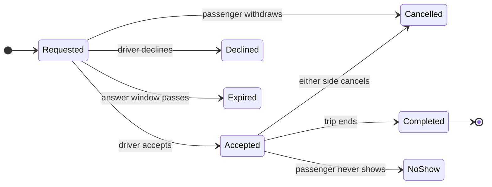
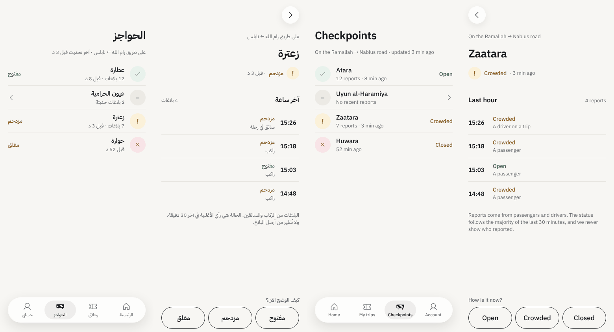
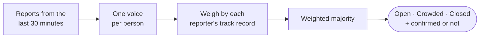
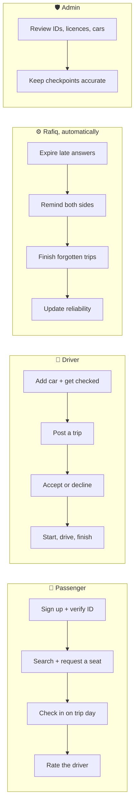
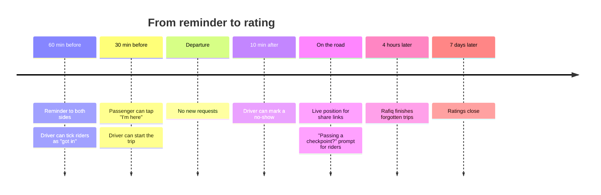
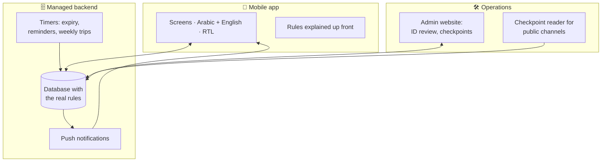

  

<h1 align="center">Rafiq · رفيق</h1>

  <b>Book a seat in a verified driver's car between West Bank cities.</b> 
  Know who's driving, what it costs, and which checkpoints are open, before you leave.

  
  
  
  

---

## Why Rafiq

Moving between cities in the West Bank today means waiting at a service-taxi stand, hoping a car fills up, and guessing whether the road ahead is open. Rafiq (Arabic for *companion*) turns that guess into **certainty**:

- 🪑 **A booked seat, not a hope.** Pick a trip, request a seat, and the driver confirms it. Clear price, pay the driver in cash.
- 🪪 **Know who's driving.** Every driver is checked by hand: ID, licence, car and plate. Passengers verify their ID too.
- 🚧 **Checkpoints before you reach them.** Live status from passengers, drivers and public channels, weighted by how reliable each reporter has been.
- 🌸 **Women-only trips.** Verified women drivers and passengers only, when you want it.

  

## How a ride works

Every seat request has a clear life, and the app always tells both sides where it stands:

The closer the trip, the faster a driver must answer, so nobody is left waiting on the morning of a commute:

| Request sent before departure | Driver must answer within |
|---|---|
| More than 24 hours | 6 hours |
| 6 to 24 hours | 2 hours |
| Less than 6 hours | 30 minutes |

## Checkpoints, crowdsourced

  

People hold a button to report a checkpoint as **open**, **crowded** or **closed**. Rafiq turns many voices into one word:

Checkpoints on a trip's way are filled in automatically from real drives on that route, and followers get a push when a status changes.

## Built on trust

| Signal | What it means |
|---|---|
| ✅ **Verified** | ID checked by a person. Drivers also show licence, car and plate. |
| 📈 **Reliability** | Share of trips that went as promised. Late cancels and no-shows count against it. |
| ⭐ **Ratings** | Both sides rate each other after a trip: stars plus short tags. |
| 🏅 **Founding driver** | A permanent badge for the first drivers who helped launch Rafiq. |
| 📍 **Share my trip** | Send a live link to someone you trust while you ride. |

Contact details and the plate only appear once a seat is confirmed, and drivers who cancel late again and again are paused from posting for a week.

## The rules of the road

Rafiq's business logic is enforced by the backend, so no app version can skip it. The main rules at a glance:

### Who acts, across one trip

One account can be both passenger and driver; the driver side opens once a car is added.

### Cancelling

| Who | Free | Counts as late |
|---|---|---|
| Passenger | Until 12 h before departure, or within 15 minutes of a late acceptance. Withdrawing an unanswered request is always free. | Cancelling a confirmed seat inside 12 h |
| Driver | Cancelling while only unanswered requests exist | Cancelling a trip or a confirmed seat inside 12 h. A closed checkpoint is an accepted excuse. |

**3 late cancels in 30 days** pause a driver from posting for 7 days. A trip can't be cancelled once it has started.

### What each side sees, and when

| Detail | Browsing | Request sent | Seat confirmed |
|---|---|---|---|
| Route, time, price, seats left | ✅ | ✅ | ✅ |
| Driver's name, rating, reliability, car model | ✅ | ✅ | ✅ |
| Profile photos | — | — | ✅ |
| Phone number and plate | — | — | ✅ |

### Money (cash pilot)

| Ending | What happens |
|---|---|
| Trip completed | Passenger pays the driver in cash |
| Passenger cancels in time | Nothing owed |
| Late cancel or no-show | Nothing charged during the pilot, but it lowers reliability |
| Driver cancels | Nothing owed; a late cancel lowers the driver's reliability |

Card payments with a small per-seat service fee are built and switched off until after the pilot.

### Trip day clock

### Women-only trips

Only a woman whose gender was confirmed at ID review can post one, and only verified women can see it in search or ask for a seat. The setting locks once anyone has asked for a seat.

### Weekly trips and ride alerts

- **Weekly trips:** a driver saves days and a time (for example Sunday to Thursday, 7:00), and Rafiq keeps the next 7 days posted.
- **Alert me:** when a search finds nothing, a passenger saves the route and gets one push when a matching trip appears.
- **Driver nudge:** when 3 people wait for the same route and day, drivers who drove it recently get a gentle nudge.

### Places

Trips go between any two West Bank towns. Search shows exact towns first, then trips that start and end close by. The driver picks a pickup point; checkpoints on the way are filled in from real drives on that route.

## What's inside

The phone talks straight to a managed database, and the database is where the rules live: who may book, when a request expires, what each side may see. The app repeats those rules only to explain them before you tap. That keeps Rafiq small, cheap to run, and hard to cheat.

| Layer | Tools |
|---|---|
| Mobile | Expo (React Native) · TypeScript · Reanimated · Skia |
| Backend | Supabase (Postgres, auth, storage, realtime) · scheduled jobs |
| Admin | Web dashboard for reviewing IDs and checkpoints |
| Data | OpenStreetMap places and checkpoints · public Telegram channels |
| Delivery | GitHub Actions for tests · over-the-air app updates |

**Design:** a calm, premium look: porcelain white, graphite ink, one clay accent only when something needs you, Liquid Glass on the navigation layer. Fonts are IBM Plex Sans Arabic and IBM Plex Sans; every message is written for men and women separately in Arabic.

## Roadmap

- [x] Accounts, trips, seat requests and driver answers
- [x] Push notifications and live updates
- [x] Answer windows, cancellations and reliability
- [x] ID and driver verification with an admin review site
- [x] Live checkpoint status, crowdsourced and from public channels
- [x] Trip day: reminders, check-in, live position, ratings
- [x] Women-only trips, share my trip, emergency contact
- [x] Weekly trips and ride alerts
- [x] Every West Bank town, with checkpoints on each route
- [ ] Pilot on Ramallah ↔ Nablus with founding drivers
- [ ] App Store and Google Play builds
- [ ] Card payments and SMS sign-in after the pilot

## About

Rafiq is built by **Waleed Barghouthi** and is in active development ahead of a cash-only pilot for commuters between Ramallah and Nablus.

Screens shown are from development builds; the design keeps evolving.

The source is visible here so people can follow the project, but it is **not open source**. No part of it may be copied, reused or redistributed without written permission. See [LICENSE](LICENSE).

---

Developer setup lives in [docs/developing.md](docs/developing.md). © 2026 Waleed Barghouthi. All rights reserved.
